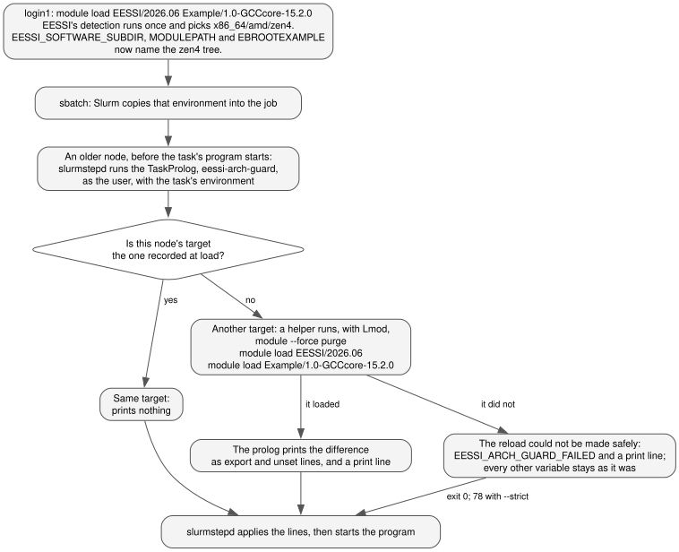
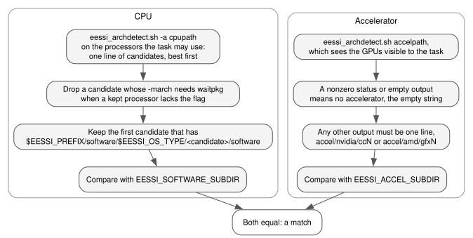

#+TITLE: How the guard decides
#+OPTIONS: toc:nil todo:nil num:nil author:nil title:nil
#+STARTUP: content

* How the guard decides

How does eessi-arch-guard tell that a task runs on a node its modules were not loaded for, and what does it change then?

** The problem

The module of the European Environment for Scientific Software Installations (EESSI) picks a CPU target once, when it is loaded, and an accelerator target the same way.
On =login1=, a zen4 machine, =module load EESSI/2026.06 Example/1.0-GCCcore-15.2.0= sets =EESSI_SOFTWARE_SUBDIR= to =x86_64/amd/zen4=, puts the zen4 module tree on =MODULEPATH=, and lets the =Example= module point =EBROOTEXAMPLE= and =PATH= into the zen4 software tree.
Slurm copies that environment into every job submitted from there.
A task that lands on a zen2 node then runs the zen4 build: it can stop with an illegal instruction, take a slower generic path, or look for a GPU tree the node does not have.

Loading the =EESSI= module again inside the job runs its detection again and moves =MODULEPATH= to the zen2 tree, but Lmod then marks every other loaded module inactive, as seen with Lmod 9.4.5.
=module reload=, an unload and load, and =module swap= leave them inactive too.
The sequence that changes the whole stack is: list the loaded modules, =module --force purge=, =module load EESSI/2026.06= by its full name, then load the others in the same order.
A batch script could run that sequence, but =srun ./a.out= starts no shell to run it in.

** How eessi-arch-guard handles it

eessi-arch-guard runs that sequence in the one place every task passes through before its program starts: the Slurm =TaskProlog=.
=slurmstepd= runs it on the compute node, as the job's user, with the task's environment, for the batch step as for every other step.
What the prolog prints on stdout, Slurm applies to the task's environment: an =export NAME=value= line sets a variable, =unset NAME= removes one, and =print TEXT= writes a line to the task's output.

#+CAPTION: From module load on the login node to the task's first instruction.
#+ATTR_RST: :alt module load on login1 records the zen4 target; Slurm copies the environment into the job; on an older node slurmstepd runs eessi-arch-guard before the program; if the node's target is the recorded one it prints nothing; otherwise a helper purges and loads the same modules with Lmod, and the prolog prints the difference, or, when the reload cannot be made, a failure marker and a message; slurmstepd applies the lines and starts the program

The /loaded target/ is what the EESSI module recorded: =EESSI_SOFTWARE_SUBDIR= for the CPU and =EESSI_ACCEL_SUBDIR= for the accelerator, which is empty when there is none.
This node's target is what EESSI's own detection script, =eessi_archdetect.sh= from the loaded version, says about the processors and GPUs the task can use.
The guard names no target itself, so it follows the trees a site has and the detection EESSI ships.

#+CAPTION: How the guard finds this node's CPU and accelerator targets.
#+ATTR_RST: :alt CPU: cpupath on the task's processors gives candidates; a candidate whose march needs waitpkg is dropped when the flag is missing; the first candidate with a software directory is kept and compared with EESSI_SOFTWARE_SUBDIR. Accelerator: accelpath; a nonzero status or empty output means none; other output must be one accel subdirectory, compared with EESSI_ACCEL_SUBDIR. Both equal is a match

*** This node's CPU

=eessi_archdetect.sh -a cpupath= prints one line of candidate subdirectories, best first, separated by colons, such as =x86_64/amd/zen4:x86_64/amd/zen3:x86_64/amd/zen2:x86_64/generic=.
The script reads =/proc/cpuinfo=, or the file =EESSI_PROC_CPUINFO= names, and judges by the last processor listed there.
A cgroup cpuset, the affinity mask or a Slurm CPU binding can keep a task off that processor, so the guard first works out which processors the task may run on: the intersection of its affinity mask, the =cpuset.cpus.effective= of its cgroup, and =SLURM_CPU_BIND_LIST= or =SLURM_CPU_BIND=.
When that leaves fewer processors than the file lists, or processors that differ, the script is given one processor record whose flags are the ones every kept processor has.

The guard then drops a candidate whose compiler target needs a flag that a kept processor lacks.
It checks one flag, =waitpkg=: EESSI's detection does not ask for it, but GCC's =-march= for =sapphirerapids= and twelve other Intel targets uses it, so a virtual machine that hides the flag is offered binaries that stop with an illegal instruction.

Of the candidates left, the first that has a software directory, =$EESSI_PREFIX/software/$EESSI_OS_TYPE/<candidate>/software=, is this node's CPU target.
When the waitpkg rule removed the candidate that the EESSI module's own walk would choose, the reload pins the module to the guard's choice with =EESSI_SOFTWARE_SUBDIR_OVERRIDE=.
[[file:../reference/cpu-flags.org][CPU flags]] lists the targets the rule covers.
[[py:eessi_arch_guard.probe_cpu]] and [[zig:eessi-arch-guard.guard.probeCpu]] make this choice in the two builds.

*** This node's accelerator

=eessi_archdetect.sh accelpath= prints the accelerator subdirectory for the GPUs the task can see, such as =accel/nvidia/cc90= on =gpu003=.
A nonzero exit status or empty output means no accelerator, which the EESSI module records as an empty =EESSI_ACCEL_SUBDIR=.
The guard compares the string as it is printed.
The fallback from a compute capability such as =cc86= to the directory of its major version, =cc80=, stays in the EESSI module, which runs it during the reload.
[[py:eessi_arch_guard.probe_accel]] and [[zig:eessi-arch-guard.guard.probeAccel]] run the detection.

*** Match, reload or failure

The node matches when its CPU target is =EESSI_SOFTWARE_SUBDIR= and its accelerator is =EESSI_ACCEL_SUBDIR=; the guard then prints nothing.
It also prints nothing when EESSI is not loaded, when =EESSI_ARCH_GUARD=0= turns it off, and when the user pinned the detection with =EESSI_SOFTWARE_SUBDIR_OVERRIDE= or =EESSI_ARCHDETECT_OPTIONS_OVERRIDE=.
=EESSI_ACCELERATOR_TARGET_OVERRIDE= leaves the accelerator out of the comparison.

Otherwise a helper process runs the sequence above with the =LMOD_CMD= of the task's environment: =module --force purge=, a load of the =EESSI= module by its full name, then one load of the other modules in the order =LOADEDMODULES= lists them.
When that last load fails, the helper loads them again one call each, so that a module from a tree that an earlier module adds still loads, and the message names every module that has no build for this node.
The prolog prints the difference between the task's environment and the one the helper ends with, and sets =EESSI_ARCH_GUARD_RELOADED=.

A reload that cannot be made, or made safely, changes nothing but =EESSI_ARCH_GUARD_FAILED=, and the =print= line says why.
The prolog exits 0 in that case too, because Slurm kills a task whose =TaskProlog= exits nonzero: a job that would have run on the wrong tree still runs.
With =--strict=, a failed decision exits 78 instead.
[[py:eessi_arch_guard.decide]] and [[zig:eessi-arch-guard.guard.decide]] make the whole decision.

** What was considered and turned down

- /Naming targets in the guard./
  An Intel node with NVIDIA A100 GPUs could be =x86_64/intel/icelake= or =x86_64/intel/skylake_avx512=, and a name baked into the program would be wrong on the other kind of node and on every AMD node.
  The guard takes the first candidate the detection offers that the site has installed.
- /Loading only the EESSI module again./
  It moves =MODULEPATH= and leaves every other module inactive.
- /Editing the module path and the list of loaded modules in place./
  The modules set paths of their own, such as =EBROOTEXAMPLE=, and only running the modulefiles again sets them for the new tree.
- /Letting the detection script judge the whole machine./
  =eessi_archdetect.sh= would describe the last processor in =/proc/cpuinfo=, which the task may never run on.
- /Doing the accelerator fallback in the guard./
  The module already does it when it is loaded, from the string the detection printed.
- /A job prolog, which Slurm runs as root once per job./
  It does not run in the task's environment, and it sees GPUs that the task's cgroup hides.

** Limits

- The guard follows =eessi_archdetect.sh=: a wrong answer from the script is a wrong target for the guard too.
- Of the flags a target's =-march= uses beyond the ones the detection checks, only =waitpkg= is checked.
- A module with no build for the node's target stops the reload, and the task runs with the environment it was submitted with.
- Programs built with =-march=native= on a login node, and virtual environments with compiled wheels, are outside the module tree, and the guard does not change them.
- To turn the guard off, =EESSI_ARCH_GUARD=0= has to be in the environment the job is submitted with.
  On Slurm 23.11.4, =srun --export=ALL,EESSI_ARCH_GUARD=0= gave a task =1= when =EESSI_ARCH_GUARD=1= was already set.

** Further reading

- [[file:../howto/warn-at-module-load.org][Warn at module load]] is the Lmod =load= hook for an interactive shell. A job that inherited its modules does not run it.
- [[file:../tutorials/first-guarded-job.org][See the guard reload EESSI for another CPU]] shows a reload and a failure.
- [[file:design.org][Why a task prolog runs the reload]] covers the prolog, the helper and the failure policy.
- [[file:output-modes.org][Prolog lines and shell lines]] covers what the guard prints, and how the tasks of a step share one decision.
- [[file:../reference/compatibility.org][Compatibility]] lists every input and output of the decision, as the Zig build keeps them.
- [[https://github.com/stackhands/eessi-arch-guard/blob/main/DESIGN.md][DESIGN.md]] is the maintainers' record of the design and of what was rejected.
